<p align="center">
  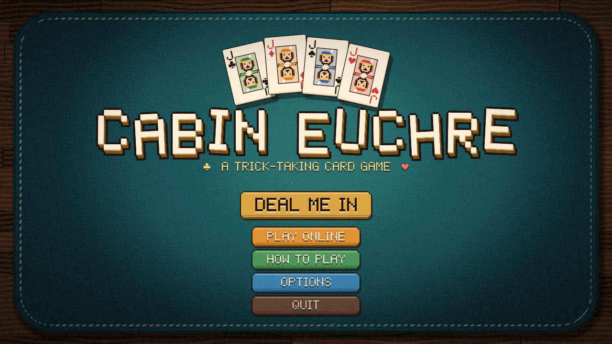
</p>

<h1 align="center">Cabin Euchre</h1>

<p align="center">
  <strong>Pull up a chair. Lamp's on, cards are out, and Benny needs a partner.</strong><br>
  Classic euchre on a lamp-lit cabin table, on your PC, phone or tablet.
</p>

<p align="center">
  <em>Coming to Steam, the App Store and Google Play.</em>
</p>

---

## The card game of the Great Lakes, the way it's meant to feel

Euchre belongs on a kitchen table at the lake, with the wood stove going and someone keeping score
on the back of an envelope. Cabin Euchre brings that table to you: worn walnut, a felt mat, a lamp
swaying overhead and a pencil score pad with real tally marks.

Every card has weight. They hop when they flip, lean toward your cursor and snap down on the felt
with a good, punchy sound. It's lively, it's cozy, and it's very hard to play just one more hand.

<p align="center">
  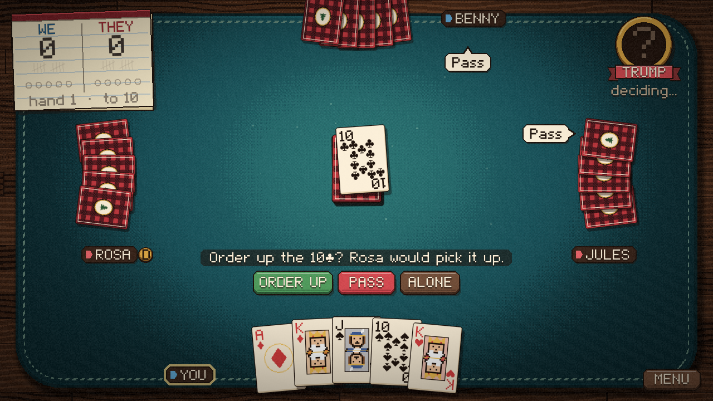
</p>

## The real rules, not a watered-down version

- **Right and left bowers**, ordering up, naming trump and all the rest
- **Go alone** when your hand is too good to share
- **Stick the dealer**, on or off
- **Play to 5, 7 or 10**, and watch the points tick up on the score pad

## Never played? Benny will teach you

**Learn to Play** is a real match against Rosa and Jules with your partner Benny talking you through it.
The first hand he points at every move. By the last one he keeps quiet and just watches, to see if
you've got it. There's a hint if you get stuck, and a pop quiz or two. No walls of text.

<p align="center">
  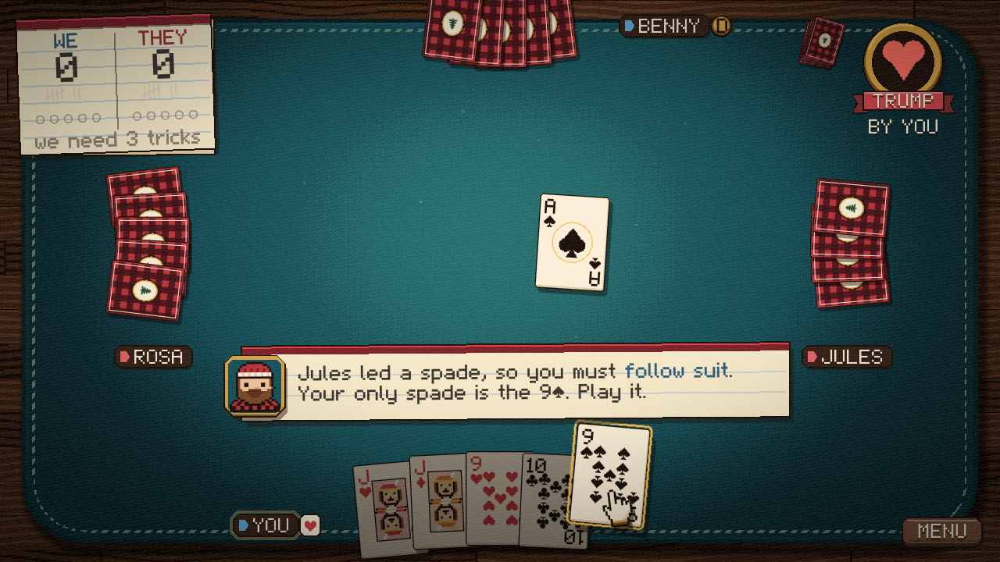
</p>

Prefer to read? The illustrated **How to Play** covers it all.

<table>
  <tr>
    <td>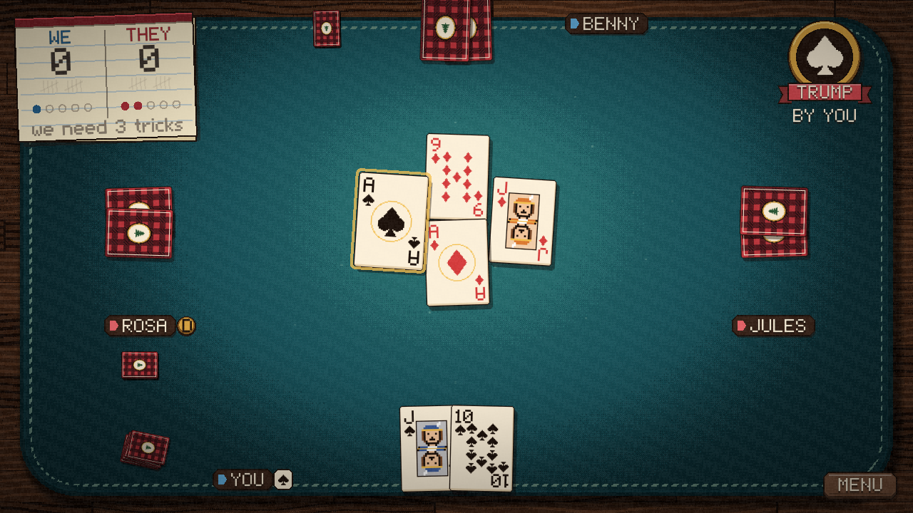</td>
    <td>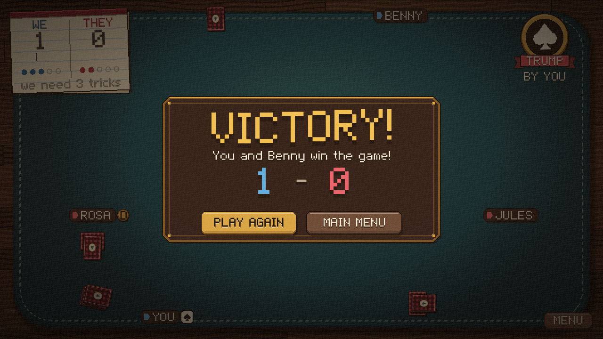</td>
  </tr>
  <tr>
    <td align="center"><em>Trump takes the trick</em></td>
    <td align="center"><em>Bragging rights secured</em></td>
  </tr>
</table>

## Bring your friends to the table

Host a table, share the 6-letter code, and everyone sits right down. Tables are private unless you
say otherwise, and bots keep any empty seats warm, so two of you can take on the house or fill all
four chairs.

**PC and mobile players share the same tables.** Your cousin on the couch with a phone and your
buddy on Steam can sit down together. On Steam, you can also send invites, and friends can ask to
join right from their friends list.

<p align="center">
  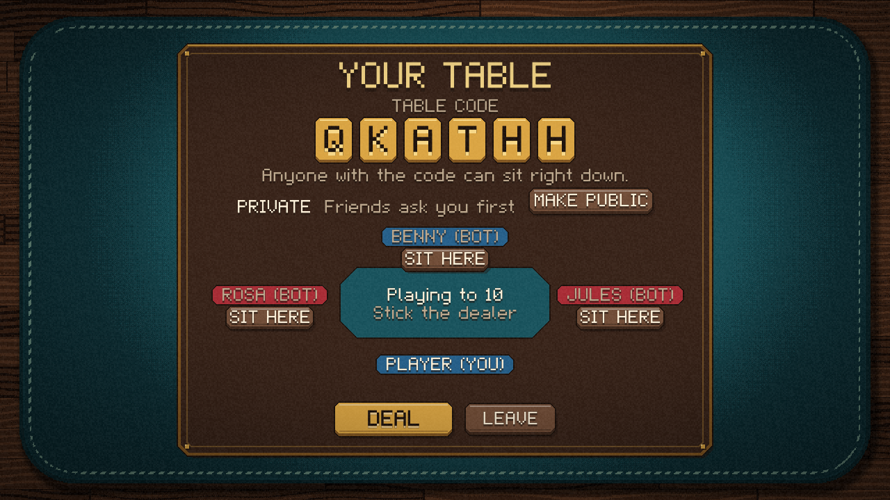
</p>

## A full table in your pocket

Cabin Euchre isn't a PC game squeezed onto a small screen. Phones and tablets get their own layouts,
with big buttons for your thumbs and a table that runs edge to edge.

<table>
  <tr>
    <td>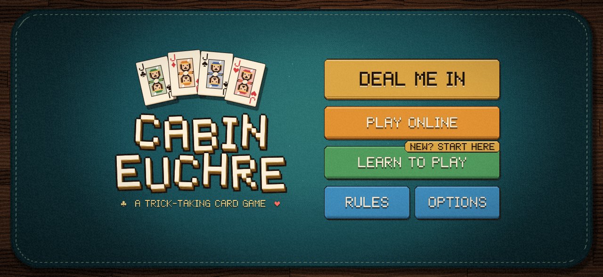</td>
    <td>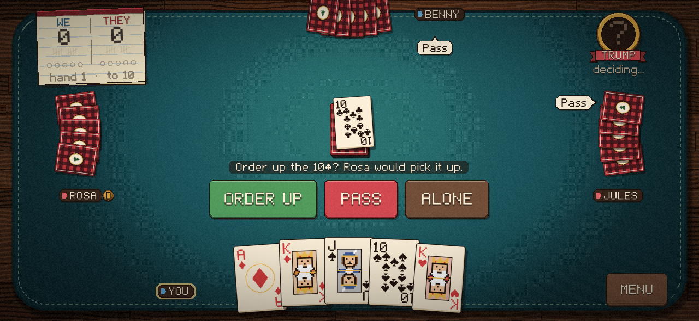</td>
  </tr>
  <tr>
    <td>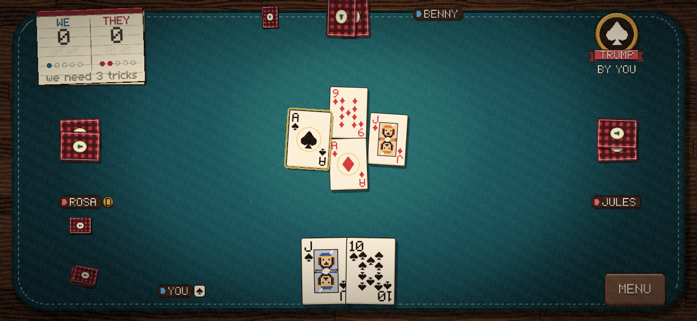</td>
    <td>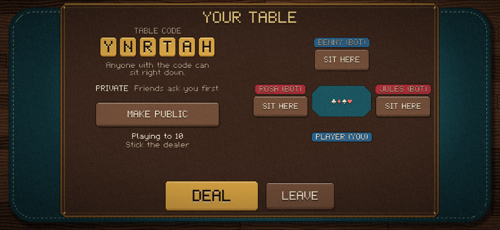</td>
  </tr>
</table>

<p align="center">
  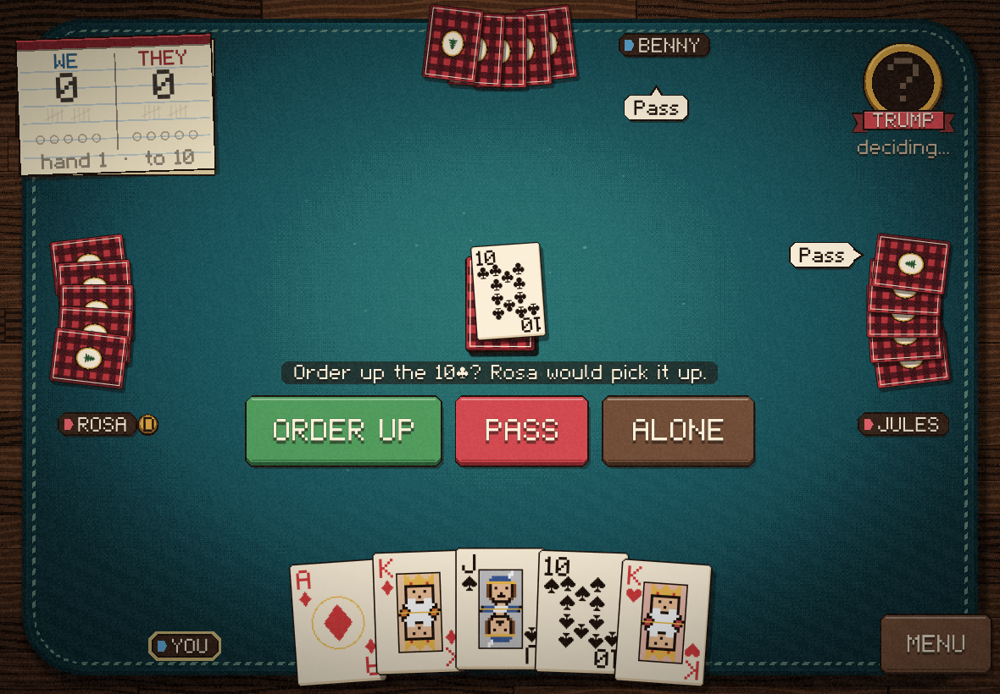
</p>

## Play it your way

- **Mouse, keyboard, touchscreen or gamepad**, with rumble on controllers
- **Save and quit** any time, then pick up right where you left off
- **24 trophies to earn and your lifetime record**, synced with Steam, Game Center or Google Play Games
- **Set your own pace** with relaxed, normal and fast game speeds
- **Windows, macOS, Linux, iOS and Android**

---

<p align="center">
  <strong>Cabin Euchre</strong><br>
  The lamp's on. Deal me in.
</p>

<details>
<summary>Build it yourself</summary>

You'll need Rust 1.88 or newer.

```sh
cargo run --release
```

Cabin Euchre is written in Rust on the [love2drs](https://github.com/gccody/Love2DRS) framework.

</details>
